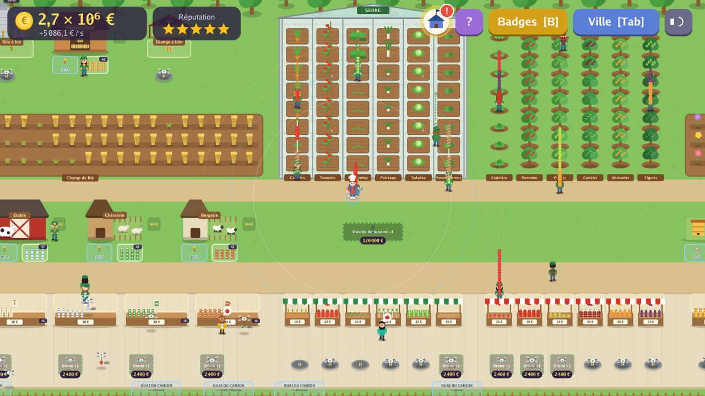
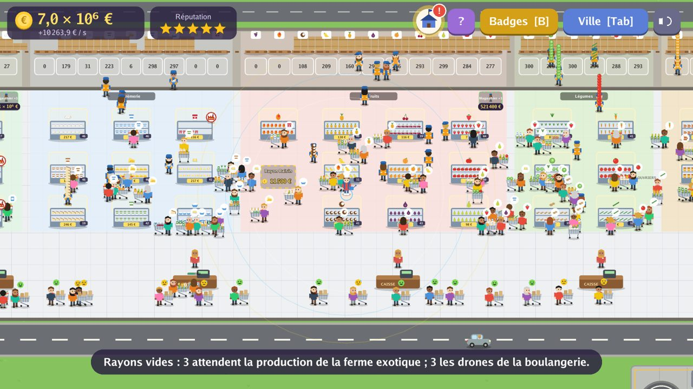
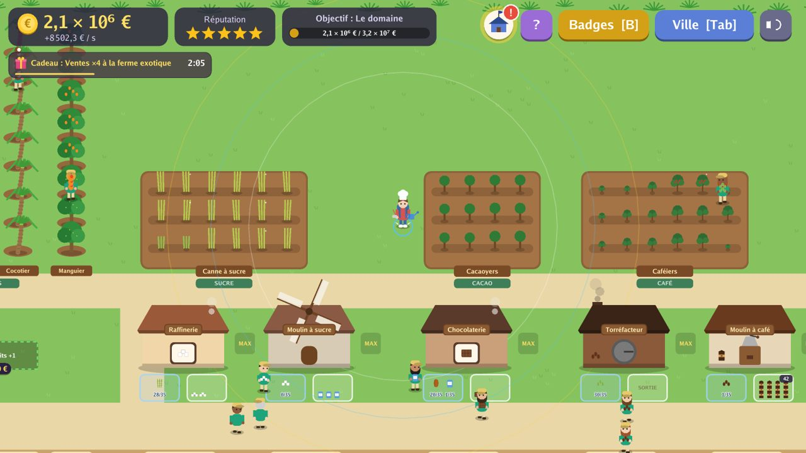
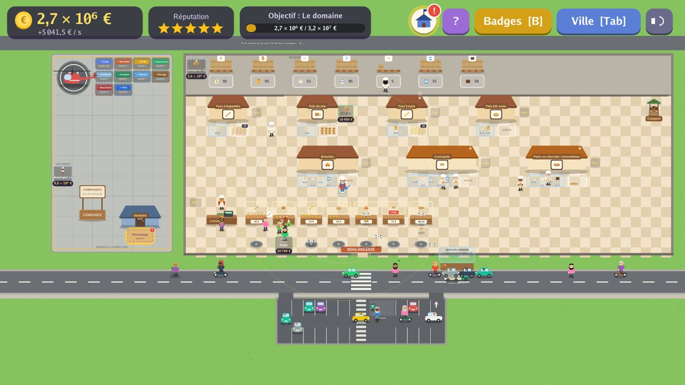

# Toute une Ville

**[Français](#français) · [English](#english)**



---

## Français

**Toute une Ville** est un jeu de gestion « idle » pour Windows. Tu construis la ville de **Clairbourg**, lieu après lieu : une ferme, un supermarché, une école, une crèmerie, une ferme exotique, une boulangerie, un glacier, un port, une ferme d'élevage, une boucherie, un domaine viticole, une pâtisserie… Tu récoltes, tu fabriques, tu vends, tu embauches. Puis tes employés, tes drones et tes camions travaillent pour toi, même quand le jeu est fermé.

### ⬇️ Télécharger

**[Télécharger la dernière version (ToutUneVille.zip)](https://github.com/Nathalie314/Toute-une-ville/releases/latest/download/ToutUneVille.zip)**

1. Télécharge le fichier `.zip`.
2. Fais un clic droit dessus, puis **« Extraire tout »**.
3. Lance **`ToutUneVille.exe`**.

> **Windows affiche « Windows a protégé votre ordinateur » ?**
> C'est normal pour un petit jeu fait maison qui n'est pas « signé » (un certificat payant).
> Clique sur **« Informations complémentaires »**, puis sur **« Exécuter quand même »**.

La partie est enregistrée automatiquement, dans un fichier à côté du jeu (`ToutUneVille_sauvegarde.json`).

### 🎮 Commandes

| Touche | Action |
|---|---|
| Flèches, ZQSD ou clic maintenu | Se déplacer |
| Molette, + et − | Zoomer |
| Tab | Carte de la ville |
| 1 à 9, 0 | Aller dans un lieu favori |
| , ou ? | Aide |
| B | Badges |
| M | Couper le son |
| F11 | Plein écran |

Pour acheter quelque chose, il suffit de **rester immobile sur sa case** : l'argent s'y verse petit à petit.

### 📸 Aperçu

| | |
|---|---|
|  |  |
|  |  |

### 💬 Donner ton avis

Le jeu est en cours de création et ton avis m'aide beaucoup !
- **[Signaler un bug](https://github.com/Nathalie314/Toute-une-ville/issues/new?template=bug.yml)**
- **[Proposer une idée](https://github.com/Nathalie314/Toute-une-ville/issues/new?template=idee.yml)**

(Il faut un compte GitHub, gratuit.)

### ❤️ Soutenir le jeu

Je crée ce jeu sur mon temps libre, avec l'aide d'une intelligence artificielle (Claude), qui a un coût. Si le jeu te plaît et que tu veux m'aider à continuer, tu peux me soutenir sur **[Tipeee](https://fr.tipeee.com/nathalie314/)**. Merci ! 🙏

### 📜 Licence

**Toute une Ville** est créé par **Nathalie314**. Il est publié sous la licence **[Creative Commons BY-NC-SA 4.0](https://creativecommons.org/licenses/by-nc-sa/4.0/deed.fr)** :
- ✅ tu peux jouer, copier, partager, **modifier** et améliorer le jeu ;
- ✍️ en citant l'autrice (Nathalie314) et un lien vers ce dépôt ;
- 🚫 **pas d'utilisation commerciale** : on ne gagne pas d'argent avec ;
- 🔁 une version modifiée doit garder **la même licence**.

### 🛠️ Pour les développeurs

Le jeu est écrit en **Go** avec la bibliothèque **[Ebitengine](https://ebitengine.org/)**.
- `sim/` : toute la simulation, sans dessin (lieux, employés, clients, camions, drones, école, commandes…).
- La racine : le dessin, l'interface, la sauvegarde sur disque et le son.
- `cmd/balance` : un simulateur d'équilibrage (un robot joue tout seul en accéléré).
- `NOTES.md` : l'histoire du projet et toutes les décisions de conception.

```bash
go build -ldflags "-H windowsgui" -o ToutUneVille.exe .
```

```bash
go test ./sim
```

---

## English

**Toute une Ville** ("A Whole Town") is an idle management game for Windows. You build the town of **Clairbourg**, one place at a time: a farm, a supermarket, a school, a dairy, an exotic farm, a bakery, an ice-cream parlour, a harbour, a livestock farm, a butcher's shop, a wine estate, a pastry shop… You harvest, craft, sell and hire. Then your workers, drones and trucks keep working for you, even while the game is closed.

*The game is in French.*

### ⬇️ Download

**[Download the latest version (ToutUneVille.zip)](https://github.com/Nathalie314/Toute-une-ville/releases/latest/download/ToutUneVille.zip)**

1. Download the `.zip` file.
2. Right-click it, then choose **"Extract All"**.
3. Run **`ToutUneVille.exe`**.

> **Windows says "Windows protected your PC"?**
> That's normal for a small home-made game that isn't "signed" (a paid certificate).
> Click **"More info"**, then **"Run anyway"**.

Your game is saved automatically, in a file next to the game (`ToutUneVille_sauvegarde.json`).

### 🎮 Controls

| Key | Action |
|---|---|
| Arrow keys, WASD/ZQSD or hold the mouse button | Move |
| Mouse wheel, + and − | Zoom |
| Tab | Town map |
| 1 to 9, 0 | Go to a favourite place |
| , or ? | Help |
| B | Badges |
| M | Mute |
| F11 | Full screen |

To buy something, just **stand still on its square**: the money pours in little by little.

### 📸 Screenshots

See the pictures in the French section above.

### 💬 Feedback

The game is a work in progress and your feedback helps a lot!
- **[Report a bug](https://github.com/Nathalie314/Toute-une-ville/issues/new?template=bug.yml)**
- **[Suggest an idea](https://github.com/Nathalie314/Toute-une-ville/issues/new?template=idee.yml)**

(You need a free GitHub account.) English is welcome.

### ❤️ Support the game

I make this game in my spare time, with the help of an AI (Claude), which costs money. If you like the game and want to help me keep going, you can support me on **[Tipeee](https://fr.tipeee.com/nathalie314/)**. Thank you! 🙏

### 📜 License

**Toute une Ville** is made by **Nathalie314**. It is released under the **[Creative Commons BY-NC-SA 4.0](https://creativecommons.org/licenses/by-nc-sa/4.0/)** license:
- ✅ you may play, copy, share, **modify** and improve the game;
- ✍️ as long as you credit the author (Nathalie314) with a link to this repository;
- 🚫 **no commercial use**: nobody makes money with it;
- 🔁 modified versions must keep **the same license**.

### 🛠️ For developers

The game is written in **Go** with the **[Ebitengine](https://ebitengine.org/)** library.
- `sim/`: the whole simulation, without any drawing (places, workers, customers, trucks, drones, school, orders…).
- Root folder: drawing, user interface, saving to disk and sound.
- `cmd/balance`: a balancing simulator (a bot plays on its own, fast-forwarded).
- `NOTES.md`: the history of the project and every design decision (in French).

```bash
go build -ldflags "-H windowsgui" -o ToutUneVille.exe .
```

```bash
go test ./sim
```
