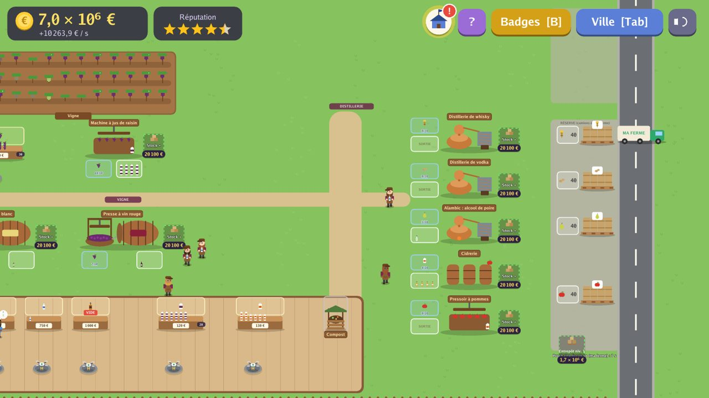

# Toute une Ville

**[Français](#français) · [English](#english)**

🇫🇷 Jeu en français et en anglais · 🇺🇸 Game in English and French


---

## Français

**Toute une Ville** est un jeu de gestion « idle » **bilingue français / anglais**, pour Windows et le navigateur. Tu construis la ville de **Clairbourg**, lieu après lieu : une ferme, un supermarché, une école, une crèmerie, une ferme exotique, une boulangerie, un glacier, un port, une ferme d'élevage, une boucherie, un domaine viticole, une crêperie (le premier restaurant : cuisine, salle, terrasse, serveurs et pourboires), une pâtisserie, un parc d'attractions (avec ses manèges, ses stands et son grand huit), une huilerie (tournesol, colza, lin, oliviers, noisetiers, noyers et leurs presses)… Tu récoltes, tu fabriques, tu vends, tu embauches. Puis tes employés, tes drones et tes camions travaillent pour toi, même quand le jeu est fermé.

Mais la ville attire aussi les **voleurs** : ils attaquent un lieu, font fuir les clients et vident les caisses. Le **commissariat** (commissaire, voitures de police, lieutenants et capitaines formés à l'école) envoie des patrouilles qui protègent les lieux de ton choix, surveille les autres par vidéosurveillance et garde à vue les voleurs arrêtés. La **prison** (directeur, surveillants, cellules, cantine, salle de bain, salle de sport, salles des familles, atelier, psy et assistant social) les aide à se réinsérer : chaque voleur réinséré quitte la ville pour toujours. Le commissariat et la prison passent aussi leurs commandes, chacun selon son rang : croissants des lieutenants, fraisier du commissaire, foie gras du directeur… Dès la boulangerie, attention aux **incendies** : un lieu qui a des fours peut brûler et revenir à zéro. La **caserne de pompiers** les prévient (chargés de prévention) et sauve ce qu'elle peut (camions de pompiers).

*Le jeu existe en français et en anglais : la langue se choisit au premier lancement, ou avec les drapeaux de la carte de la ville. Au tout début, un **tutoriel** (facultatif) te guide pas à pas : ferme, école, mairie, vestiaire. Envie de le traduire dans ta langue ? Tout est expliqué dans [langues/LISEZMOI.txt](langues/LISEZMOI.txt).*

### ⬇️ Télécharger pour Windows

**[Télécharger la dernière version (ToutUneVille.zip)](https://github.com/Nathalie314/Toute-une-ville/releases/latest/download/ToutUneVille.zip)**

1. Télécharge le fichier `.zip`.
2. Fais un clic droit dessus, puis **« Extraire tout »**.
3. Lance **`ToutUneVille.exe`**.

> **Windows affiche « Windows a protégé votre ordinateur » ?**
> C'est normal pour un petit jeu fait maison qui n'est pas « signé » (un certificat payant).
> Clique sur **« Informations complémentaires »**, puis sur **« Exécuter quand même »**.

La partie est enregistrée automatiquement, dans un fichier à côté du jeu (`ToutUneVille_sauvegarde.json`).

### 🎮 Commandes (clavier et souris)

| Touche | Action |
|---|---|
| Flèches, ZQSD ou clic maintenu | Se déplacer |
| Molette, + et − | Zoomer |
| Tab | Carte de la ville |
| 1 à 9, 0 | Aller dans un lieu favori |
| , ou ? | Aide |
| B | Badges |
| $ | Gestion de l'argent (tableau des gains) |
| Échap | Quitter le jeu (la partie est enregistrée) |
| M | Couper le son (les boutons du son coupent aussi séparément les sons du jeu, le téléphone, la musique) |
| F11 | Plein écran |

Pour acheter quelque chose, il suffit de **rester immobile sur sa case** : l'argent s'y verse petit à petit.

### 🌐 Jouer dans le navigateur (iPad, Mac, Linux…)

**[Jouer à Toute une Ville dans le navigateur](https://nathalie314.github.io/Toute-une-ville/)**, sans rien installer.
- Sur ordinateur : les mêmes touches que ci-dessus.
- Sur tablette : **garde le doigt posé** pour te déplacer, **pince** pour zoomer.
- Sur iPad, « Partager » → **« Sur l'écran d'accueil »** l'ouvre en plein écran, comme une application.
- La partie est gardée dans le navigateur de l'appareil (elle n'est pas partagée avec la version Windows).
- Le premier chargement télécharge environ 19 Mo.

### 📸 Aperçu

| | |
|---|---|
|  |  |
|  |  |

### 💬 Donner ton avis

Le jeu est en cours de création et ton avis m'aide beaucoup !
- **[Signaler un bug](https://github.com/Nathalie314/Toute-une-ville/issues/new?template=bug.yml)**
- **[Proposer une idée](https://github.com/Nathalie314/Toute-une-ville/issues/new?template=idee.yml)**

(Il faut un compte GitHub, gratuit.)

### ❤️ Soutenir le jeu

Je crée ce jeu sur mon temps libre, avec l'aide d'une intelligence artificielle (Claude), qui a un coût. Si le jeu te plaît et que tu veux m'aider à continuer, tu peux me soutenir sur **[Tipeee](https://fr.tipeee.com/nathalie314/)**. Merci ! 🙏

### 📜 Licence

**Toute une Ville** est créé par **Nathalie314**. Il est publié sous la licence **[Creative Commons BY-NC-SA 4.0](https://creativecommons.org/licenses/by-nc-sa/4.0/deed.fr)** :
- ✅ tu peux jouer, copier, partager, **modifier** et améliorer le jeu ;
- ✍️ en citant l'autrice (Nathalie314) et un lien vers ce dépôt ;
- 🚫 **pas d'utilisation commerciale** : on ne gagne pas d'argent avec ;
- 🔁 une version modifiée doit garder **la même licence**.

### 🛠️ Pour les développeurs

Le jeu est écrit en **Go** avec la bibliothèque **[Ebitengine](https://ebitengine.org/)**.
- `sim/` : toute la simulation, sans dessin (lieux, employés, clients, camions, drones, école, commandes…).
- La racine : le dessin, l'interface, la sauvegarde sur disque et le son.
- `cmd/balance` : un simulateur d'équilibrage (un robot joue tout seul en accéléré).
- `NOTES.md` : l'histoire du projet et toutes les décisions de conception.

```bash
go build -ldflags "-H windowsgui" -o ToutUneVille.exe .
```

```bash
go test ./sim
```

---

## English

**Toute une Ville** ("A Whole Town") is a **bilingual English / French** idle management game, for Windows and the browser. You build the town of **ClearTown** (*Clairbourg* in French), one place at a time: a farm, a supermarket, a school, a dairy, an exotic farm, a bakery, an ice-cream parlour, a harbour, a livestock farm, a butcher's shop, a wine estate, a creperie (the first restaurant: kitchen, dining room, terrace, servers and tips), a pastry shop, an amusement park (with its rides, its stands and its roller coaster), an oil mill (sunflower, rapeseed, flax, olive, hazel and walnut trees, and their presses)… You harvest, craft, sell and hire. Then your workers, drones and trucks keep working for you, even while the game is closed.

But the town also draws **thieves**: they raid a place, scare the customers away and empty the registers. The **police station** (a police chief, police cars, lieutenants and captains trained at the school) sends out patrols that protect the places you choose, watches the others with CCTV and holds the arrested thieves in custody. The **prison** (warden, guards, cells, cafeteria, washroom, gym, family rooms, workshop, psychologist and social worker) helps them get back on track: every rehabilitated thief leaves the town for good. The police station and the prison place their own orders too, each by rank: the lieutenants' croissants, the chief's strawberry cake, the warden's foie gras… From the bakery on, watch out for **fires**: a place with ovens can burn down and go back to square one. The **fire station** prevents them (fire prevention officers) and saves what it can (fire trucks).

*The game is available in English and in French: choose your language at first launch, or with the flags on the town map. At the very start, an optional **tutorial** guides you step by step: farm, school, city hall, locker room.*

### ⬇️ Download for Windows

**[Download the latest version (ToutUneVille.zip)](https://github.com/Nathalie314/Toute-une-ville/releases/latest/download/ToutUneVille.zip)**

1. Download the `.zip` file.
2. Right-click it, then choose **"Extract All"**.
3. Run **`ToutUneVille.exe`**.

> **Windows says "Windows protected your PC"?**
> That's normal for a small home-made game that isn't "signed" (a paid certificate).
> Click **"More info"**, then **"Run anyway"**.

Your game is saved automatically, in a file next to the game (`ToutUneVille_sauvegarde.json`).

### 🎮 Controls (keyboard and mouse)

| Key | Action |
|---|---|
| Arrow keys, WASD/ZQSD or hold the mouse button | Move |
| Mouse wheel, + and − | Zoom |
| Tab | Town map |
| 1 to 9, 0 | Go to a favourite place |
| , or ? | Help |
| B | Badges |
| $ | Money management (earnings table) |
| Esc | Quit the game (your game is saved) |
| M | Mute (the sound buttons can also mute the game sounds, the phone, the music separately) |
| F11 | Full screen |

To buy something, just **stand still on its square**: the money pours in little by little.

### 🌐 Play in your browser (iPad, Mac, Linux…)

**[Play Toute une Ville in your browser](https://nathalie314.github.io/Toute-une-ville/)**, nothing to install.
- On a computer: the same keys as above.
- On a tablet: **keep your finger down** to move, **pinch** to zoom.
- On an iPad, "Share" → **"Add to Home Screen"** opens it full screen, like an app.
- Your game is stored in the device's browser (it is not shared with the Windows version).
- The first load downloads about 19 MB.

### 📸 Screenshots

See the pictures in the French section above.

### 💬 Feedback

The game is a work in progress and your feedback helps a lot!
- **[Report a bug](https://github.com/Nathalie314/Toute-une-ville/issues/new?template=bug.yml)**
- **[Suggest an idea](https://github.com/Nathalie314/Toute-une-ville/issues/new?template=idee.yml)**

(You need a free GitHub account.) English is welcome.

Want to translate the game into your language? See [langues/LISEZMOI.txt](langues/LISEZMOI.txt) (in French and English).

### ❤️ Support the game

I make this game in my spare time, with the help of an AI (Claude), which costs money. If you like the game and want to help me keep going, you can support me on **[Tipeee](https://fr.tipeee.com/nathalie314/)**. Thank you! 🙏

### 📜 License

**Toute une Ville** is made by **Nathalie314**. It is released under the **[Creative Commons BY-NC-SA 4.0](https://creativecommons.org/licenses/by-nc-sa/4.0/)** license:
- ✅ you may play, copy, share, **modify** and improve the game;
- ✍️ as long as you credit the author (Nathalie314) with a link to this repository;
- 🚫 **no commercial use**: nobody makes money with it;
- 🔁 modified versions must keep **the same license**.

### 🛠️ For developers

The game is written in **Go** with the **[Ebitengine](https://ebitengine.org/)** library.
- `sim/`: the whole simulation, without any drawing (places, workers, customers, trucks, drones, school, orders…).
- Root folder: drawing, user interface, saving to disk and sound.
- `cmd/balance`: a balancing simulator (a bot plays on its own, fast-forwarded).
- `NOTES.md`: the history of the project and every design decision (in French).

```bash
go build -ldflags "-H windowsgui" -o ToutUneVille.exe .
```

```bash
go test ./sim
```
